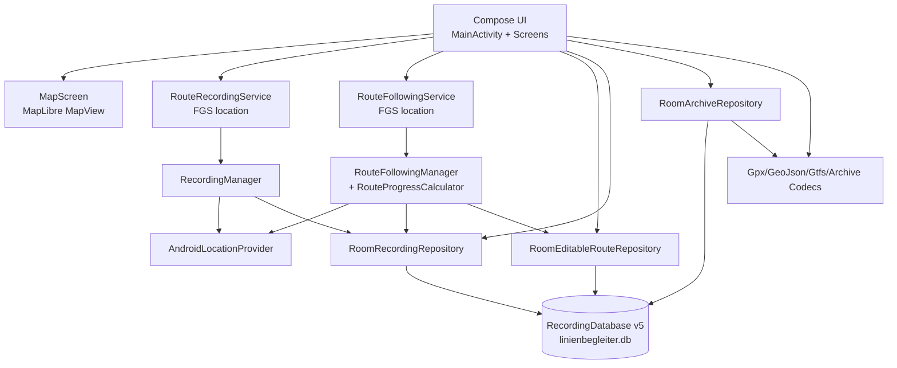
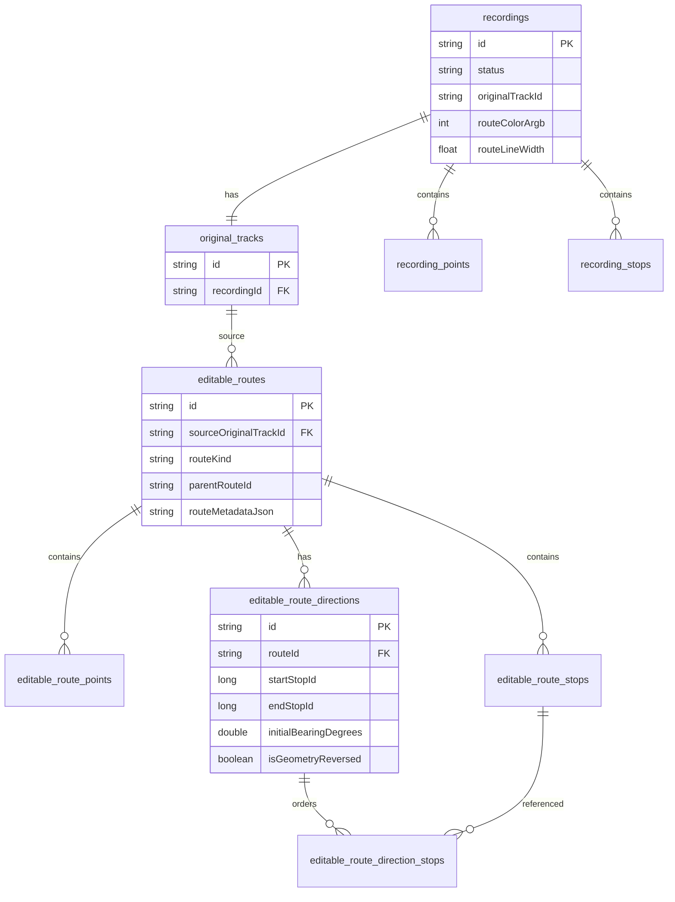

# AI_README.md — технический контекст Linienbegleiter для ИИ-агентов

> **Назначение файла:** это не пользовательская документация и не замена [`README.md`](README.md).  
> Это **техническая карта проекта и инструкция по безопасному продолжению разработки** для ИИ-агентов в новых сессиях без доступа к прошлым чатам. Обзор границ подсистем и потоков данных вынесен в [`ARCHITECTURE.md`](ARCHITECTURE.md).
>
> **Приоритет истины:** при любом противоречии между документами и кодом побеждает **текущий исходный код**. Документацию нужно исправлять, а не «подгонять» код под устаревший текст.

| Поле | Значение |
|---|---|
| Дата аудита | **2026-11-16** |
| Версия документа | 1.0 |
| Статус аудита | Полный статический аудит кода + схем Room + тестов |
| Git-история | **Отсутствует** (`NO_GIT_REPO`) — хронология восстановлена по косвенным признакам |
| Изменение app-кода в рамках аудита | **Нет** (только документация) |

---

## Оглавление

1. [Паспорт проекта](#1-паспорт-проекта)
2. [История проекта](#2-история-проекта--от-идеи-до-текущего-состояния)
3. [Эволюция архитектуры](#3-эволюция-архитектуры)
4. [Карта исходного кода](#4-подробная-карта-исходного-кода)
5. [Архитектура и правила взаимодействия](#5-архитектура-и-правила-взаимодействия)
6. [Модель данных](#6-модель-данных)
7. [Подробное описание функций](#7-подробное-описание-функций)
8. [GPS и местоположение](#8-gps-и-местоположение)
9. [Карта и геометрия](#9-карта-и-геометрия-маршрутов)
10. [Импорт и экспорт](#10-импорт-и-экспорт)
11. [Тестирование](#11-тестирование-и-контроль-качества)
12. [Проблемы и долг](#12-текущие-проблемы-и-технический-долг)
13. [Реализовано / частично / нет](#13-реализовано--частично-реализовано--не-реализовано)
14. [План развития](#14-план-дальнейшего-развития)
15. [Правила для ИИ](#15-правила-для-будущих-ии-агентов)
16. [Правила ведения документации](#16-правила-ведения-документации)
17. [Сводка последних изменений](#25-сводка-последних-изменений-для-продолжения-разработки)

---

## 1. Паспорт проекта

### 1.1. Суть продукта — CONFIRMED

**Linienbegleiter** — персональное локальное Android-приложение для:

- записи автобусных/транспортных маршрутов по GPS;
- ручного создания и редактирования геометрии линий и остановок;
- хранения GPS-записей и самостоятельных сохранённых маршрутов; редактирование источника создаёт независимый маршрут;
- следования по сохранённому маршруту с индикацией прогресса;
- локального импорта/экспорта (GPX, GeoJSON, GTFS Static, собственный архив Room).

Приложение **не** является облачным сервисом, навигатором turn-by-turn общего назначения или полноценным GTFS-редактором расписаний.

### 1.2. Технический паспорт — CONFIRMED

| Параметр | Значение | Источник |
|---|---|---|
| Платформа | Android | `app/build.gradle.kts` |
| Язык | Kotlin | исходники `*.kt` |
| UI | Jetpack Compose + Material 3 | зависимости + экраны |
| Карта | MapLibre Android SDK 13.7.1 | `gradle/libs.versions.toml` |
| Стиль карты | OpenFreeMap Liberty | `MapScreen.kt` → `OPENFREEMAP_LIBERTY_STYLE` |
| Хранение | Room 2.8.5, БД `linienbegleiter.db` v5 | `RecordingDatabase.kt` |
| Фоновые задачи | 2× Foreground Service (`location`) | `AndroidManifest.xml` |
| Модули | один `:app` | `settings.gradle.kts` |
| `applicationId` | `com.example.linienbegleiter` | `app/build.gradle.kts` |
| `minSdk` | 26 | `app/build.gradle.kts` |
| `targetSdk` / `compileSdk` | 37 | `app/build.gradle.kts` |
| AGP | 9.5.1 | `libs.versions.toml` |
| Kotlin | 2.2.10 | `libs.versions.toml` |
| KSP | 2.3.10 | `libs.versions.toml` |
| Compose BOM | 2026.02.01 | `libs.versions.toml` |
| Gradle Wrapper | 9.6.0 | `gradle-wrapper.properties` |
| `versionName` / `versionCode` | `1.0` / `1` | `app/build.gradle.kts` |
| Язык UI | русский | тексты экранов |
| DI | отсутствует (ручное создание) | репозитории через `remember` |
| Навигация | ручной `AppScreen` state machine | `MainActivity.kt` |

### 1.3. Архитектурный подход — CONFIRMED

Фактически:

```text
UI (Compose)
  → Services (FGS) / Managers (координация состояния)
    → Repositories
      → Room DAO / Entities
```

Дополнительно:

- `LocationProvider` / `AndroidLocationProvider` — геолокация;
- `data/interchange/*` — файловый обмен через нейтральную модель `InterchangeRoute`;
- MapLibre `MapView` встроен в Compose через `AndroidView` в `MapScreen`.

### 1.4. Состояние на момент аудита — PARTIALLY VERIFIED

| Уровень | Статус |
|---|---|
| Код компилируется (`assembleDebug`) | CONFIRMED в предыдущей сессии разработки (2026-11-16) |
| Unit-тесты | CONFIRMED: 16 passed (`:app:testDebugUnitTest`) |
| AndroidTest compile | CONFIRMED: `compileDebugAndroidTestKotlin` успешен |
| AndroidTest на устройстве/эмуляторе | **UNVERIFIED** в этом аудите |
| Ручная проверка на физическом телефоне | **UNVERIFIED** |
| Git | отсутствует |

---

## 2. История проекта — от идеи до текущего состояния

### 2.0. Методология восстановления истории

| Источник | Доступность | Использование |
|---|---|---|
| Git commits / branches | **Нет** | — |
| Room schema JSON v1–v5 | Да | эволюция модели данных |
| Миграции в `RecordingDatabase` | Да | смысл каждого шага схемы |
| Текущий код и KDoc | Да | фактические возможности |
| Тесты | Да | закреплённые инварианты |
| `gradle-wrapper.properties` timestamp | Да | `#Sun Nov 15 11:42:14 CET 2026` — ориентир появления wrapper |
| `README.md` | Да | краткое состояние; не полная история |
| Предыдущие сессии разработки | Частично (через уже существующий код/README) | контекст фич, не даты |

**Важно:** ниже — **логическая** последовательность, восстановленная по схемам и зависимостям кода. Точные календарные даты этапов **неизвестны**, кроме ориентира wrapper (15 Nov 2026) и даты аудита (16 Nov 2026). Если два изменения нельзя упорядочить строго, это указано явно.

### 2.1. Этап A — Идея и стартовый Android-проект

| Поле | Содержание |
|---|---|
| Этап | Bootstrap Android / Compose |
| Цель | Создать базовое приложение под локальную работу с автобусными маршрутами |
| Реализация | Модуль `:app`, `MainActivity`, тема Compose, launcher |
| Изменённые файлы | `settings.gradle.kts`, `app/build.gradle.kts`, `MainActivity.kt`, `ui/theme/*`, манифест, ресурсы |
| Технические решения | Single-module app; Compose; без Hilt/Navigation3 |
| Проверка | Проект открывается/собирается как стандартный AS template (предположительно) |
| Результат | Каркас приложения | CONFIRMED по наличию стандартной структуры |
| Ограничения | Нет бизнес-логики |
| Даты | UNVERIFIED; wrapper датирован 2026-11-15 |

### 2.2. Этап B — UI-оболочка и навигация

| Поле | Содержание |
|---|---|
| Этап | Экраны HOME / ROUTES / SETTINGS + создание маршрута |
| Цель | Русскоязычный каркас пользовательских сценариев |
| Реализация | `AppScreen` enum, bottom bar, placeholder «рисование» |
| Файлы | `MainActivity.kt` |
| Решения | Ручной state machine вместо Navigation Compose — меньше зависимостей |
| Проверка | UI-код присутствует | CONFIRMED |
| Результат | Навигация между основными сценариями |
| Ограничения | `DRAW` остаётся заглушкой до сих пор |
| Порядок относительно карты/Room | Точный порядок UI vs MapLibre **не установлен** |

### 2.3. Этап C — Карта MapLibre

| Поле | Содержание |
|---|---|
| Этап | Интеграция MapLibre + OpenFreeMap |
| Цель | Отображать Германию/маршруты без проприетарного Maps SDK |
| Реализация | `MapScreen.kt` (~1200 строк), слои GeoJSON, камера в SharedPreferences |
| Файлы | `MapScreen.kt`, зависимость `maplibre-android-sdk` |
| Решения | OpenFreeMap Liberty URL; локальные иконки остановок/стрелок |
| Проверка | Код слоёв и style URL — CONFIRMED; полевая отрисовка на устройстве — UNVERIFIED |
| Результат | Переиспользуемая карта для записи/редактирования/следования/preview импорта |
| Ограничения | Требует сеть для тайлов; рисование пальцем не сделано |

### 2.4. Этап D — Room v1: GPS-запись и оригинальный трек

| Поле | Содержание |
|---|---|
| Этап | Локальное хранение записи |
| Цель | Сохранять GPS-точки и остановки; зафиксировать immutable original track |
| Реализация | Таблицы `recordings`, `original_tracks`, `recording_points`, `recording_stops` |
| Файлы | `RecordingEntities.kt`, `RecordingDaos.kt`, `RecordingDatabase.kt`, `RecordingRepository.kt`, schema `1.json` |
| Решения | UUID string PK для сессий/треков; autoincrement для точек/остановок; статусная модель записи |
| Проверка | Schema v1 + `RecordingRepositoryTest` | CONFIRMED |
| Результат | База GPS-данных |
| Ограничения | Пока без editable routes |

### 2.5. Этап E — Foreground Service записи + LocationProvider

| Поле | Содержание |
|---|---|
| Этап | Фоновая запись маршрута |
| Цель | Продолжать запись при свёрнутом UI |
| Реализация | `RouteRecordingService`, `RecordingManager`, `AndroidLocationProvider` |
| Файлы | `service/RouteRecordingService.kt`, `data/recording/*`, `data/location/*`, манифест permissions/FGS |
| Решения | FGS type `location`; канал уведомлений; actions start/pause/resume/stop/addStop/restore; фильтр дистанции по accuracy/gap/speed |
| Проверка | Код сервиса и manager — CONFIRMED; поведение на OEM-прошивках — UNVERIFIED |
| Результат | Рабочий контур записи |
| Ограничения | Нет `ACCESS_BACKGROUND_LOCATION`; запись завязана на FGS, не на «always-on tracking» |
| Порядок vs карта | Логически после/параллельно карте; точный порядок UNVERIFIED |

### 2.6. Этап F — Room v2: редактируемые маршруты

| Поле | Содержание |
|---|---|
| Этап | Отдельная editable-копия |
| Цель | Редактировать маршрут, не портя GPS-оригинал |
| Реализация | `editable_routes`, `editable_route_points`, `editable_route_stops`; `MIGRATION_1_2` |
| Файлы | `EditableRouteEntities.kt`, `EditableRouteDao.kt`, `EditableRouteRepository.kt`, schema `2.json` |
| Решения | `sourceOriginalTrackId` → original_tracks ON DELETE SET NULL; cascade delete точек/остановок маршрута |
| Проверка | Schema v2 + instrumentation isolation test | CONFIRMED |
| Результат | Модель «оригинал ≠ редакция» |
| Ограничения | Направления ещё отсутствовали |

### 2.7. Этап G — Редактор, варианты, создание точками

| Поле | Содержание |
|---|---|
| Этап | UI редактирования |
| Цель | Создавать/править геометрию и остановки |
| Реализация | `RouteEditorScreen`, `EditableRouteCreationScreen`, `SavedRoutesScreen`, `copyRoute` |
| Файлы | соответствующие `*.kt` в корне пакета |
| Решения на историческом этапе | Вариант создавался как копия с `parentRouteId` / kind `VARIANT` |
| Проверка на историческом этапе | Repository test на независимость original/edit/variant | CONFIRMED |
| Результат на тот момент | Пользовательский контур редакций |
| Ограничения | DRAW placeholder |
| Порядок vs directions | Редактор и directions могли развиваться близко; точный порядок UNVERIFIED |

**Важно: это описание прежнего состояния.** Текущая модель независимых маршрутов без пользовательских вариантов описана в §21 и §25; ориентируйтесь на них и на код.

### 2.8. Этап H — Room v3: directions + независимые координаты остановок

| Поле | Содержание |
|---|---|
| Этап | Направления движения |
| Цель | Туда/обратно, bearing, порядок остановок; остановки не обязаны совпадать с точкой пути |
| Реализация | `routeKind`, `parentRouteId`; `routePointSequence` стал nullable; таблицы directions; `MIGRATION_2_3` |
| Файлы | `EditableRouteDirectionEntities.kt`, `RouteDirectionUtils.kt`, schema `3.json` |
| Решения | Bearing по первой/последней остановке направления; reverse geometry flag |
| Проверка | Migration test seed v2 → validate v5; unit/instrumented direction asserts | CONFIRMED код+тест |
| Результат | Directions как first-class данные |
| Ограничения | UI направлений нужно сверять при изменениях редактора |

### 2.9. Этап I — Следование по маршруту (Following FGS)

| Поле | Содержание |
|---|---|
| Этап | Live following |
| Цель | Показывать прогресс по линии и ближайшие остановки |
| Реализация | `RouteFollowingService`, `RouteFollowingManager`, `RouteProgressCalculator`, `RouteFollowingScreen` |
| Решения | Проекция на полилинию; окна backtrack/lookahead; взаимное исключение с записью через `hasSavedFollowing` |
| Проверка | Код — CONFIRMED; unit-тестов на calculator отдельно нет — PARTIALLY VERIFIED; device — UNVERIFIED |
| Результат | Режим следования |
| Ограничения | Не turn-by-turn; зависит от качества GPS и геометрии |

### 2.10. Этап J — Room v4: оформление линии

| Поле | Содержание |
|---|---|
| Этап | Цвет и толщина |
| Цель | Различать маршруты на карте |
| Реализация | `routeColorArgb`, `routeLineWidth` у recordings и editable_routes; `RouteColorPalette`; `MIGRATION_3_4` |
| Файлы | entities, `RouteAppearanceControls.kt`, palette tests |
| Результат | Стабильная палитра + ручной выбор |
| Ограничения | `0` трактуется как «автоцвет» в UI/палитре (см. код экранов) |

### 2.11. Этап K — GPX / GeoJSON import-export

| Поле | Содержание |
|---|---|
| Этап | Файловый обмен геометрией |
| Цель | Обмен с внешними инструментами без root storage permission |
| Реализация | `GpxCodec`, `GeoJsonCodec`, `InterchangeModels`, `ImportExportScreen`, SAF |
| Решения | Нейтральная `InterchangeRoute`; multi-segment → отдельные маршруты; stops только у первого кандидата |
| Проверка | `RouteFileCodecTest` | CONFIRMED |
| Результат | Рабочий GPX/GeoJSON контур |
| Ограничения | Не полный GPX 1.1 feature set; не все GeoJSON geometry types |

### 2.12. Этап L — Room v5 + GTFS Static

| Поле | Содержание |
|---|---|
| Этап | GTFS + metadata |
| Цель | Импорт расписаний/shapes; re-export без выдуманного календаря |
| Реализация | `routeMetadataJson`; `GtfsCodec`/`GtfsCsvCodec`; kind `GTFS_IMPORT`; `MIGRATION_4_5` |
| Решения | Хранить исходные таблицы в metadata; запрет экспорта при изменённых stops; правка shape допускается |
| Проверка | `GtfsCodecTest` (в т.ч. reject edited stops) | CONFIRMED |
| Результат | Частичная GTFS-поддержка |
| Ограничения | Не весь GTFS; без shapes — маршрут без геометрии |

### 2.13. Этап M — Собственный архив `.linienbegleiter.zip` + UI wiring

| Поле | Содержание |
|---|---|
| Этап | Полный backup/restore Room |
| Цель | Резервная копия всех локальных данных |
| Реализация | `LinienbegleiterArchiveCodec`, `RoomArchiveRepository` (export/inspect/import), UI preview/confirm |
| Решения | manifest+SHA-256; remap IDs; RECORDING→PAUSED; не стартовать FGS на импорте |
| Проверка | Unit codec tests + `RoomArchiveRepositoryTest` (compile confirmed; device run UNVERIFIED) |
| Результат | Backup append-only |
| Ограничения | Не merge-by-id / не replace-all |

### 2.14. Этап N — Документация для людей/агентов

| Поле | Содержание |
|---|---|
| Этап | README + AI_README |
| Цель | Передача контекста |
| Реализация | `README.md` (краткий), `AI_README.md` (этот аудит) |
| Дата | 2026-11-16 |
| Результат | Разделение short/long docs |

### 2.15. Что не удалось восстановить достоверно

- точные даты этапов A–M;
- авторские commit messages и ветки;
- порядок внедрения MapLibre относительно Room v1;
- порядок Following относительно Room v3/v4;
- какие багфиксы были до архива;
- результаты тестов на реальном телефоне пользователя.

---

## 3. Эволюция архитектуры

### 3.1. Первоначальная структура (логическая)

```text
MainActivity (Compose UI shell)
```

Затем появились независимые контуры:

1. Map rendering (`MapScreen`)
2. Recording persistence (Room v1 + repository)
3. Recording runtime (Manager + FGS)
4. Editable routes (Room v2+)
5. Following runtime (Manager + FGS)
6. Interchange codecs + Import UI
7. Archive repository

### 3.2. Почему Services + Managers

- **Service** нужен Android для FGS/уведомлений и переживания фона.
- **Manager** держит доменное состояние (`StateFlow`), фильтры GPS, progress math — чтобы Service не раздувался SQL/геометрией.
- **Repository** изолирует Room/транзакции от UI и OS.

### 3.3. Текущая архитектура — CONFIRMED



### 3.4. Запрещённые обходы архитектуры

- UI → прямой SQL / `SupportSQLiteDatabase` в экранах;
- новый параллельный Location stack без причины;
- запись точек в обход `RecordingManager`/`Repository` во время активной сессии;
- импорт напрямую в DAO без repository/codec правил;
- второй FGS того же назначения.

---

## 4. Подробная карта исходного кода

Пути относительно корня проекта.

### 4.1. Gradle / конфигурация

| Файл | Назначение | Основные элементы | Связи |
|---|---|---|---|
| `settings.gradle.kts` | имя проекта, include `:app` | `rootProject.name` | весь билд |
| `build.gradle.kts` | root plugins | AGP/Kotlin/KSP apply false | subprojects |
| `gradle/libs.versions.toml` | versions catalog | AGP/Kotlin/Room/MapLibre/Compose | `app/build.gradle.kts` |
| `app/build.gradle.kts` | app module | sdk, ksp room schema, deps | runtime |
| `gradle.properties` | JVM/config cache | `org.gradle.configuration-cache=true` | build |
| `gradle/wrapper/gradle-wrapper.properties` | Gradle 9.6.0 | distributionUrl | CI/local |
| `app/src/main/AndroidManifest.xml` | permissions, FGS, activity | services exported=false | OS |
| `app/schemas/.../1.json`…`5.json` | Room schema export | entity DDL | migrations/tests |

### 4.2. UI / навигация

| Файл | Назначение | Основные классы/функции | Связи |
|---|---|---|---|
| `app/src/main/java/.../MainActivity.kt` | точка входа, tabs, screen switch | `MainActivity`, `LinienbegleiterApp`, `AppScreen`, Home/Settings/Create | все экраны |
| `MapScreen.kt` | карта | `MapScreen`, GeoJSON builders | все map-сценарии |
| `RecordingScreen.kt` | UI записи | bind service, controls | `RouteRecordingService` |
| `RouteFollowingScreen.kt` | UI следования | start/stop follow | `RouteFollowingService` |
| `RouteEditorScreen.kt` | редактор | save points/stops/directions | `RoomEditableRouteRepository` |
| `EditableRouteCreationScreen.kt` | создание точками | createRoute | repository + MapScreen |
| `SavedRoutesScreen.kt` | единый каталог | follow/edit-as-new/appearance/delete | repos + services |
| `ImportExportScreen.kt` | SAF import/export | codecs + archive preview | interchange + archive |
| `RouteAppearanceControls.kt` | цвет/толщина | UI controls | palette |
| `ui/theme/*.kt` | тема | Color/Type/Theme | Compose |

### 4.3. Services / Managers / Location

| Файл | Назначение | Основные API | Связи |
|---|---|---|---|
| `service/RouteRecordingService.kt` | FGS записи | `start/pause/resume/stop/addStop/restore` | RecordingManager |
| `service/RouteFollowingService.kt` | FGS следования | `start/stop/restore/hasSavedFollowing` | RouteFollowingManager |
| `data/recording/RecordingManager.kt` | runtime записи | `startRecording`, `addLocationPoint`, `addStop`, … | repo + location |
| `data/routes/RouteFollowingManager.kt` | runtime follow | `startFollowing`, progress | both repos + location |
| `data/location/LocationProvider.kt` | контракт GPS | start/stop/getCurrent/lastKnown | managers/map |
| `data/location/AndroidLocationProvider.kt` | реализация LocationManager | HandlerThread updates | OS |
| `data/location/LocationSample.kt` | DTO + `isSuitableForStop` | — | recording/following |

### 4.4. Repositories / Room

| Файл | Назначение | Основные API | Связи |
|---|---|---|---|
| `data/local/RecordingDatabase.kt` | Room DB v5 + migrations | `getInstance`, MIGRATION_1_2…4_5 | все repos |
| `data/local/RecordingEntities.kt` | recording tables | entities + converters | DAOs |
| `data/local/EditableRouteEntities.kt` | editable tables | entities | DAOs |
| `data/local/EditableRouteDirectionEntities.kt` | directions | entities | DAOs |
| `data/local/RecordingDaos.kt` | recording DAOs | CRUD/observe/backup | repos |
| `data/local/EditableRouteDao.kt` | editable DAOs | CRUD/directions/backup | repos |
| `data/local/RoomArchiveRepository.kt` | full backup | `export/inspect/import` | codecs + DB |
| `data/recording/RecordingRepository.kt` | recording repo interface+impl | session lifecycle | managers/UI |
| `data/recording/RecordingModels.kt` | domain models | statuses/details | UI |
| `data/routes/EditableRouteRepository.kt` | editable repo | create independent/update/directions/delete | UI/follow |
| `data/routes/EditableRouteModels.kt` | editable domain | kinds/details | UI |
| `data/routes/RouteFollowingModels.kt` | follow DTOs | progress snapshot | UI |
| `data/routes/RouteDirectionUtils.kt` | bearing/directions | `createRouteDirections` | editor |
| `data/routes/RouteColorPalette.kt` | colors | `automaticFor`, `toMapLibreColor` | map/UI |

### 4.5. Interchange

| Файл | Назначение | API | Связи |
|---|---|---|---|
| `data/interchange/InterchangeModels.kt` | нейтральная модель | `InterchangeRoute` | все codecs |
| `GpxCodec.kt` | GPX r/w | `read/write` | ImportExport |
| `GeoJsonCodec.kt` | GeoJSON r/w | `read/write` | ImportExport |
| `GtfsCodec.kt` | GTFS ZIP | `read/write`, validators | ImportExport |
| `GtfsCsvCodec.kt` | CSV parse/write | BOM/quotes | GtfsCodec |
| `LinienbegleiterArchiveCodec.kt` | archive ZIP | manifest+sha256 | archive repo |
| `JsonCodec.kt` | минимальный JSON | stringify/parse helpers | codecs/archive |

### 4.6. Тесты

| Файл | Назначение |
|---|---|
| `app/src/test/.../RouteFileCodecTest.kt` | GPX/GeoJSON |
| `.../GtfsCodecTest.kt` | GTFS |
| `.../LinienbegleiterArchiveCodecTest.kt` | archive checksum |
| `.../RouteColorPaletteTest.kt` | palette |
| `app/src/androidTest/.../RecordingRepositoryTest.kt` | recording persistence |
| `.../EditableRouteRepositoryTest.kt` | независимое сохранение маршрута и направления; старые variant-сценарии не являются актуальным пользовательским flow |
| `.../RecordingDatabaseMigrationTest.kt` | migrate seeded v2 → v5 |
| `.../RoomArchiveRepositoryTest.kt` | archive remap |

---

## 5. Архитектура и правила взаимодействия

### 5.1. UI

**Ответственность:** отображение, ввод, запрос permissions, запуск service actions, вызов repositories для CRUD, preview импорта.

**Не должен:** писать сырой SQL; держать долгоживущие GPS-подписки вместо service (кроме map display updates); менять original track полями «на месте».

### 5.2. Services

**Ответственность:** FGS lifecycle, notification, bind state, restore после process death (частично через saved prefs / active session).

`RouteRecordingService` actions: START, RESTORE, PAUSE, RESUME, STOP, ADD_STOP.  
`RouteFollowingService` actions: START, RESTORE, STOP; persist routeId/source/directionId in SharedPreferences `route_following`.

### 5.3. Managers

**Ответственность:** доменные правила runtime, mutex, StateFlow, фильтрация точек, progress.

Взаимное исключение — CONFIRMED:

- старт записи проверяет `!RouteFollowingService.hasSavedFollowing`;
- при конфликте показывается ошибка в notification/state;
- UI following также блокирует параллельные сценарии.

### 5.4. Repositories

**Ответственность:** транзакции Room, валидация координат/заголовков, mapping entity↔domain, backup queries.

### 5.5. Room

**Ответственность:** схема, FK/indexes, migrations, schema export для MigrationTestHelper.

Текущая версия: **5**. Новая версия ⇒ новая migration + schema JSON + тест.

---

## 6. Модель данных

### 6.1. Принцип оригинала — CONFIRMED

GPS-запись имеет собственный original track. Текущий редактор сохраняет изменения в новый независимый маршрут без ссылок `sourceOriginalTrackId` и `parentRouteId`; исходная запись/маршрут остаётся неизменным. Поля и enum-значения старых связей сохранены для совместимого чтения Room v5, но новый пользовательский flow их не создаёт. Актуальный тест независимости: `EditableRouteRepositoryTest.editedRouteIsIndependentFromGpsRecording`.

### 6.2. Таблицы

#### `recordings` — `RecordingEntity`

| Поле | Тип | Назначение |
|---|---|---|
| `id` PK TEXT | UUID сессии |
| `title` | название |
| `created/started/finishedAtEpochMillis` | lifecycle timestamps |
| `status` | IDLE/RECORDING/PAUSED/FINISHED |
| `totalDistanceMeters`, `durationSeconds` | агрегаты |
| `originalTrackId` | связь с original |
| `routeColorArgb`, `routeLineWidth` | оформление (с v4) |

#### `original_tracks` — `OriginalTrackEntity`

| Поле | Тип | Назначение |
|---|---|---|
| `id` PK | UUID трека |
| `recordingId` FK → recordings CASCADE | 1:1 |
| `createdAt` / `finalizedAt` | создание/финиш |

#### `recording_points` / `recording_stops`

- PK autogen Long;
- unique `(recordingId, sequence)`;
- points хранят accuracy/speed/bearing/elapsedRealtimeNanos;
- stops — name + lat/lon + timestamp;
- FK CASCADE от recordings.

#### `editable_routes` — `EditableRouteEntity`

| Поле | Назначение |
|---|---|
| `id` | UUID |
| `sourceOriginalTrackId` | FK original SET NULL |
| `routeKind` | MANUAL/RECORDING_EDIT/VARIANT/FILE_IMPORT/GTFS_IMPORT |
| `parentRouteId` | вариант |
| `distanceMeters` | оценка длины |
| appearance fields | цвет/толщина |
| `routeMetadataJson` | GTFS tables etc. (v5) |

Points/stops editable — CASCADE. `routePointSequence` nullable (с v3).

#### Directions

- `editable_route_directions`: start/end stop ids, bearing, `isGeometryReversed`;
- `editable_route_direction_stops`: order of stop ids per direction;
- CASCADE от route/direction.

### 6.3. ER-диаграмма (фактическая)



### 6.4. Эволюция схемы — CONFIRMED по JSON

| Version | Добавлено |
|---|---|
| 1 | recordings + original_tracks + recording_points/stops |
| 2 | editable_routes/points/stops |
| 3 | routeKind/parentRouteId; nullable routePointSequence; directions tables |
| 4 | appearance columns |
| 5 | routeMetadataJson |

---

## 7. Подробное описание функций

Ниже — ключевые публичные/критичные API. Не полный листинг каждой private helper-функции.

### 7.1. RecordingManager

| Метод | Назначение | Читает | Меняет | Ошибки |
|---|---|---|---|---|
| `startRecording(recordingId)` | старт updates + status RECORDING | active session | state, repo status, location start | нет активной/неверный статус |
| `pauseRecording()` | пауза, checkpoint duration | state | status PAUSED, stop location | |
| `resumeRecording()` | продолжение | state | RECORDING + location | |
| `stopRecording()` | finish + finalize track | state | FINISHED, aggregates | |
| `addLocationPoint(sample)` | сохранить точку, обновить distance | sample/session | points + aggregates | игнор если не RECORDING |
| `addStop(name)` | стоп по fresh fix | `latestSample` | recording_stops | `NoFreshLocationException` |
| `restoreActiveRecording()` | восстановить runtime после рестарта сервиса | repo active | state/location | |

**Правила дистанции:** точка участвует в distance, если не stale и accuracy ≤ `stopMaximumAccuracyMeters`; сегмент учитывается при timeDelta∈(0..60s] и speed ≤ 45 m/s.

### 7.2. RoomRecordingRepository

| Метод | Меняет | Инварианты |
|---|---|---|
| `createSession` | recordings + original_tracks | не более одной active |
| `startRecording` | status/timestamps | |
| `appendPoint/appendStop` | child rows + sequences | только незавершённая запись; finish запрещает append |
| `finishRecording` | FINISHED + finalize track | |
| `getDetails*` / observe* | read | |

### 7.3. RoomEditableRouteRepository

| Метод | Назначение |
|---|---|
| `createRoute(...)` | создать независимый маршрут (GTFS допускает пустую геометрию) |
| `updateRoute(...)` | обновить уже созданный маршрут: geometry/stops/directions/appearance/metadata |
| независимые ID | ID точек/остановок черновика сбрасываются перед вставкой, Room назначает новые ключи |
| `saveDirections(...)` | заменить directions |
| `updateAppearance` | цвет/толщина |

Валидация: title non-empty; обычно ≥2 points (исключение empty geometry для GTFS); координаты в диапазонах; stop.routePointSequence ∈ indices или null.

### 7.4. RouteFollowingManager / ProgressCalculator

| Метод | Назначение |
|---|---|---|
| `startFollowing(routeId, source, directionId?)` | загрузить геометрию/остановки (с учётом reverse), стартовать GPS |
| `stopFollowing()` | очистить state |
| `RouteProgressCalculator.calculate` | проекция, progressMeters, prev/next stop distances, remaining points |

Константы (код): max advance 80 m, backtrack 80 m, lookahead window, stop tolerance, max match accuracy.

### 7.5. Archive

| Метод | Назначение |
|---|---|
| `RoomArchiveRepository.export` | snapshot всех таблиц → archive codec |
| `inspect` | preview counts + unfinished |
| `import` | remap IDs, transaction insert, PAUSE active recordings from archive |

Ошибки: битый checksum/version; >1 unfinished; конфликт с текущей active recording на устройстве.

### 7.6. Codecs

| Codec | read | write |
|---|---|---|
| `GpxCodec` | trk/rte/wpt | gpx 1.1 track+wpt |
| `GeoJsonCodec` | LineString/MultiLineString/Point stops | FeatureCollection |
| `GtfsCodec` | subset static GTFS | only with metadata; stop immutability check; shape rewrite |
| `LinienbegleiterArchiveCodec` | manifest+data | format/version/sha256 |

---

## 8. GPS и местоположение

### 8.1. Разрешения — CONFIRMED

В манифесте есть:

- `ACCESS_FINE_LOCATION`, `ACCESS_COARSE_LOCATION`
- `FOREGROUND_SERVICE`, `FOREGROUND_SERVICE_LOCATION`
- `POST_NOTIFICATIONS`, `INTERNET`

**Нет** `ACCESS_BACKGROUND_LOCATION`. Утверждение «приложение всегда отслеживает позицию в фоне без FGS» — **ложно**.

### 8.2. Три разных режима использования локации

| Режим | Кто подписывается | Зачем |
|---|---|---|
| Отображение на карте | `MapScreen` / provider one-shot & periodic map config | маркер/камера |
| Запись трека | `RecordingManager` via FGS | points/stops/distance |
| Следование | `RouteFollowingManager` via FGS | progress |

### 8.3. AndroidLocationProvider — CONFIRMED

- `LocationManager.requestLocationUpdates` на `HandlerThread("LinienbegleiterLocation")`;
- Fine → GPS предпочтительнее network; Approximate → network предпочтительнее;
- `getLastKnownLocation(maxAge)` фильтрует по возрасту;
- `getCurrentLocation` — temporary start + timeout;
- `latestSample` учитывает suitability для stop;
- stale: age > staleAfter или age < -5s.

Default `LocationRequestConfig`: 2s / 2m / stale 15s / stop age 10s / stop accuracy 50m.

Map config: ~5s / 5m / stale 30s.

### 8.4. Взаимное исключение записи и следования — CONFIRMED

- `RouteRecordingService.start` → `check(!hasSavedFollowing)`;
- following prefs очищаются при stop following;
- simultaneous dual GPS modes не поддерживаются продуктово.

### 8.5. Ограничения Android — PARTIALLY VERIFIED

Риски OEM battery killers, отказ уведомлений, потеря FGS, отсутствие сигнала — код обрабатывает статусы, но полевая устойчивость **UNVERIFIED**.

---

## 9. Карта и геометрия маршрутов

### 9.1. Стек карты — CONFIRMED

- MapLibre Android SDK;
- style: `https://tiles.openfreemap.org/styles/liberty`;
- камера сохраняется в `map_camera_position` SharedPreferences.

### 9.2. Слои (логические ID в `MapScreen.kt`)

- route outline + main line;
- direction arrows (`symbol-placement=line`, icon rotation map);
- original comparison line;
- passed route line;
- editable points + selected point;
- stops + labels + highlights;
- current position circle.

Цвет: `RouteColorPalette.toMapLibreColor` → `#RRGGBB`.

### 9.3. Разрывы линии

`shouldBreakTrack` / `shouldBreakRouteLine`: gap > 60s или неправдоподобная скорость > 45 m/s.

### 9.4. Направления / reverse

`RouteDirectionUtils` + following load path умеют `isGeometryReversed` (порядок точек/остановок).

### 9.5. Заглушки — CONFIRMED

- `AppScreen.DRAW` / `MapModePlaceholderScreen`: «рисование пальцем появится позже».

---

## 10. Импорт и экспорт

Общий UI: `ImportExportScreen.kt`, доступен из каталога маршрутов и настроек; возврат идёт в раздел, из которого экран открыт. Файлы обрабатываются только через SAF. Лимит чтения файла в UI: 128 MiB (`MAX_IMPORT_BYTES`).

### 10.1. GPX — CONFIRMED

| | |
|---|---|
| Поддержка | tracks/segments/points, routes, waypoints→stops |
| Multi | каждый segment/track → отдельный InterchangeRoute |
| Stops | только на первый маршрут |
| Потери | расширения GPX, не-track данные |
| Безопасность | XXE features disabled |
| Тесты | `RouteFileCodecTest` |

### 10.2. GeoJSON — CONFIRMED

| | |
|---|---|
| Поддержка | LineString, MultiLineString, Point(as stop) |
| MultiLineString | отдельные кандидаты |
| Stops | только первый |
| Appearance | route_color_argb, route_line_width |
| Потери | прочие geometry types |
| Тесты | `RouteFileCodecTest` |

### 10.3. GTFS Static — CONFIRMED (subset)

Файлы: agency, routes, trips, stops, stop_times, shapes?, calendar?, calendar_dates?.

Лимиты: 32 MiB/entry, 96 MiB total, 64 entries; unknown entries тоже читаются в лимит.

| Операция | Поведение |
|---|---|
| Import без shapes | stops+metadata+warning, geometry empty |
| Export | только с `GTFS_STATIC` metadata |
| Export + edited stops | **reject** (`primary_stops`) |
| Export + edited shape | rewrite shapes.txt / trips.shape_id; drop shape_dist_traveled |
| Export без calendar* | reject |
| Не поддерживается | fare, frequencies, pathways, realtime, nested folders, полный GTFS |

### 10.4. `.linienbegleiter.zip` — CONFIRMED

Структура:

```text
manifest.json  { format, format_version=1, payload_file, sha256 }
data.json      { recordings, originalTracks, recordingPoints, ... directions, directionStops }
```

UI: detect via `manifest.json` entry → inspect preview → confirm → remapped import.

Правила:

- add-only;
- new UUIDs / new stop row ids;
- active archive recording → PAUSED;
- no auto start FGS;
- conflict if device already has active recording and archive brings unfinished.

---

## 11. Тестирование и контроль качества

### 11.1. Инструменты

- JUnit4 unit tests;
- AndroidX / Espresso deps present;
- Room MigrationTestHelper + `androidx.room:room-testing`;
- Instrumentation runner `AndroidJUnitRunner`.

### 11.2. Unit tests (JVM) — CONFIRMED last known: 17 passed

| Тест | Сценарий |
|---|---|
| GPX/GeoJSON round-trip & multi-segment | `RouteFileCodecTest` |
| GTFS csv/import/export/edit/reject | `GtfsCodecTest` |
| Archive checksum | `LinienbegleiterArchiveCodecTest` |
| Palette | `RouteColorPaletteTest` |
| ExampleUnitTest | template |

### 11.3. Instrumented tests — COMPILE CONFIRMED, DEVICE RUN UNVERIFIED

| Тест | Сценарий |
|---|---|
| `RecordingRepositoryTest` | save/read points/stops; reject append after finish |
| `EditableRouteRepositoryTest` | independent route creation + directions |
| `RecordingDatabaseMigrationTest` | **seed v2 → migrate to v5** via 2_3+3_4+4_5 |
| `RoomArchiveRepositoryTest` | export/import remap |
| ExampleInstrumentedTest | package name |

### 11.4. Важная оговорка по миграциям

`README.md` ранее формулировал «миграции 1→5 покрыты».  
**Фактически (CONFIRMED):** тест стартует с **version 2** и валидирует до **5**.  
`MIGRATION_1_2` существует в коде, но **отдельным MigrationTestHelper-прогоном 1→2 в репозитории не подтверждён**. Статус: **PARTIALLY VERIFIED**.

### 11.5. Непроверенные сценарии (UNVERIFIED)

- длительная запись на улице / в туннеле;
- kill process mid-recording/following на OEM;
- отказ notification permission UX на API 33+;
- большие GTFS (>лимитов) на устройстве;
- визуальная регрессия MapLibre offline/no-network;
- полный androidTest suite на эмуляторе/телефоне в этом аудите.

### 11.6. Уровни проверки (не путать)

1. Компиляция ≠ работоспособность.
2. Unit-тесты ≠ GPS/FGS на устройстве.
3. Compile androidTest ≠ прогон androidTest.
4. Прогон на эмуляторе ≠ полевой тест.

---

## 12. Текущие проблемы и технический долг

| ID | Проблема | Влияние | Статус | Область | Рекомендация |
|---|---|---|---|---|---|
| TD-01 | Нет Git | нет трассировки изменений | CONFIRMED | repo root | инициализировать Git при готовности пользователя |
| TD-02 | DRAW placeholder | нет рисования пальцем | CONFIRMED | `MainActivity` | реализовывать отдельно, не ломая ADD_POINTS |
| TD-03 | Migration 1→2 без отдельного теста | риск регрессии старых установок | PARTIALLY VERIFIED | `RecordingDatabaseMigrationTest` | добавить seed v1→v5 тест |
| TD-04 | Нет unit-тестов RouteProgressCalculator | регрессии following math | CONFIRMED gap | `RouteFollowingManager.kt` | вынести calculator и покрыть |
| TD-05 | AndroidTest на устройстве не подтверждён аудитом | неизвестны runtime fails | UNVERIFIED | androidTest | прогнать connectedDebugAndroidTest |
| TD-06 | GTFS subset / stop freeze | пользователь может ждать полный editor | CONFIRMED limitation | `GtfsCodec` | явно показывать в UI |
| TD-07 | Зависимость тайлов от сети | карта пустая offline | CONFIRMED risk | MapLibre style URL | offline pack — future |
| TD-08 | Нет DI | сложнее тестировать UI | CONFIRMED | screens | не внедрять Hilt без запроса |
| TD-09 | Manual navigation state | deep links отсутствуют | CONFIRMED | MainActivity | Navigation3 только по задаче |
| TD-10 | Archive append-only | возможны дубликаты при повторном импорте | CONFIRMED | archive repo | UX warning |
| TD-11 | README называл себя главным AI-доком | путаница ролей docs | CONFIRMED contradiction | README | исправлено ссылкой на AI_README |
| TD-12 | FGS/OEM battery | запись может убиваться системой | risk UNVERIFIED field | services | мониторинг + restore paths |
| TD-13 | Нет фонового location permission | нет always-tracking | CONFIRMED by design | manifest | не добавлять без UX/policy |

---

## 13. Реализовано / частично реализовано / не реализовано

### 13.1. Реализовано — CONFIRMED кодом

| Функция | Доказательство |
|---|---|
| Compose UI + tabs | `MainActivity.kt` |
| MapLibre map + layers | `MapScreen.kt` |
| GPS recording FGS | `RouteRecordingService.kt`, `RecordingManager.kt` |
| Original track persistence | Room v1 entities + repo test |
| Независимые editable routes | `EditableRouteRepository`; тестирует отсутствие связи с GPS-записью |
| Directions | direction entities + utils + test |
| Route following FGS | `RouteFollowingService`, manager |
| Appearance palette | `RouteColorPalette` + controls |
| GPX/GeoJSON I/O | codecs + unit tests |
| GTFS subset I/O | `GtfsCodec` + tests |
| Archive backup/restore | codec + `RoomArchiveRepository` + UI |
| Import preview/confirm | `ImportExportScreen` |
| Room migrations 2→5 path | migration objects + test to v5 |
| Mutual exclusion record/follow | service checks |

### 13.2. Частично реализовано

| Функция | Что есть | Чего нет | Доказательство |
|---|---|---|---|
| GTFS | import/export subset | полный стандарт, stop editing export | `GtfsCodec` |
| Following quality | math + UI | dedicated unit tests, device soak | manager private calculator |
| Migrations coverage | 2→5 tested | explicit 1→2 test | migration test |
| Location in background | via FGS | always/background permission tracking | manifest |
| Route creation | points UI | freehand draw | DRAW placeholder |
| Archive | UI+repo | device E2E verified here | tests compile |

### 13.3. Не реализовано

| Функция | Доказательство |
|---|---|
| Рисование маршрута пальцем | `MapModePlaceholderScreen` / DRAW |
| Облако/аккаунты/синхронизация | отсутствуют модули/deps |
| Turn-by-turn голосовая навигация | нет |
| Полный GTFS editor | codec limitations |
| Offline map packs | remote style URL only |
| Navigation Compose / Hilt | отсутствуют |
| Git history | `NO_GIT_REPO` |

---

## 14. План дальнейшего развития

Не выдавать эти пункты за сделанные.

### P0 — критично

1. Прогнать `connectedDebugAndroidTest` на эмуляторе/устройстве и зафиксировать результат в этом файле.
2. Добавить migration test **1→5** (или хотя бы 1→2).
3. Инициализировать Git (по согласованию с пользователем) для трассировки.

### P1 — основной сценарий

1. Полевые тесты записи/следования (город, пауза, kill app).
2. Unit-тесты `RouteProgressCalculator`.
3. Более явные UX-предупреждения по GTFS/archive limitations.
4. Harden restore paths после process death.

### P2 — качество

1. Улучшить empty/error states карты без сети.
2. Упростить/`extract` слишком крупные composable-файлы только при необходимости задачи.
3. Snapshot/UI tests ключевых экранов.

### P3 — доп. возможности

1. Рисование пальцем (DRAW).
2. Расширение GTFS subset осознанными шагами.
3. Offline tiles.
4. Экспорт статистики маршрута.

**Не делать** rewrite с нуля без доказанной необходимости.

---

## 15. Правила для будущих ИИ-агентов

### 15.1. Перед началом любой задачи

1. Прочитать **этот** `AI_README.md`.
2. Прочитать краткий [`README.md`](README.md).
3. Проверить фактическую структуру проекта инструментами IDE (не по памяти чата).
4. Найти соответствующие классы/методы (`view_file_outline`, `find_declaration`, `grep`).
5. Изучить связанные models/DAO/repository/tests.
6. Оценить blast radius изменения (Room? FGS? codecs?).
7. Сформулировать план **до** правок.

### 15.2. Во время разработки

1. Не переписывать архитектуру без явного запроса и обоснования.
2. Не создавать дубли Location/Service/Repository «сбоку».
3. Не менять Room schema без migration + schema JSON + теста.
4. Не мутировать original GPS rows при редактировании editable route.
5. Не удалять работающие функции ради упрощения.
6. Не подменять реализацию заглушкой молча.
7. Не объявлять done без проверки соответствующего уровня.
8. Соблюдать UI → Service/Manager → Repository → Room.
9. Переиспользовать `InterchangeRoute` для новых форматов обмена.
10. Обрабатывать ошибки понятными русскими сообщениями.
11. Не добавлять Hilt/Navigation3/Play Services Location/cloud без согласования.
12. Не добавлять оплату/серверы/регистрацию/синхронизацию без отдельного ТЗ.
13. Импорт = add-only, пока продукт так задуман.
14. GTFS: не «чинить» экспорт ценой порчи timetable links.

### 15.3. После разработки

1. `assembleDebug` (минимум).
2. Релевантные unit-тесты.
3. При Room — migration/schema checks + androidTest compile/run если возможно.
4. Проверить отсутствие регрессий соседних сценариев.
5. Обновить `AI_README.md` и при необходимости `README.md`.
6. Обновить реестр проблем (§12).
7. Перечислить изменённые файлы.
8. Явно указать, **что проверено** и **что нет**.

### 15.4. Запрещено

- выдумывать результаты тестов и device QA;
- выдумывать классы/методы/файлы;
- молча overwrite пользовательских данных;
- удалять original tracks без явной команды пользователя;
- скрывать ошибки сборки;
- считать compile доказательством полной работоспособности;
- делать крупный рефакторинг вместо локального фикса;
- править файлы через shell redirects (`>`, `sed -i`) в Android Studio MCP-контексте — только IDE write/replace tools.

---

## 16. Правила ведения документации

### 16.1. Роли файлов

| Файл | Роль |
|---|---|
| `README.md` | краткий обзор для человека и быстрый onboarding |
| `AI_README.md` | полный технический контекст и история для ИИ |

При конфликте: **код > AI_README > README**.

### 16.2. Когда обновлять AI_README

После значимых изменений обязательно проверить и при необходимости обновить:

- §2 история (новый этап);
- §3–5 архитектура/связи;
- §4 карта файлов;
- §6 модель данных / version Room;
- §7–10 поведение функций/GPS/map/IO;
- §11 результаты тестов (с датой и уровнем проверки);
- §12 долг;
- §13 статусы реализовано;
- §14 план.

### 16.3. Статусы утверждений

Используй метки: `CONFIRMED` | `PARTIALLY VERIFIED` | `UNVERIFIED` | `PLANNED` | `DEPRECATED`.

Не удаляй ограничения только потому, что «планируется исправить».

### 16.4. Documentation as Code

- хранить docs рядом с кодом;
- ссылаться на реальные пути;
- не писать рекламных формулировок;
- фиксировать дату аудита/обновления.

---

## 17. Hamburg Transit — централизованная цветовая тема

`ui/theme/Color.kt` содержит `HamburgTransitPalette` с Hamburg Red, Elbe Blue, Harbor Navy, Brick, Sand, светлой/тёмной поверхностью и цветами текста. `Theme.kt` собирает из этих токенов Material 3 light/dark схемы. Существующий выбор AUTO/DAY/NIGHT в `MainActivity` продолжает определять активную схему через датчик освещённости; системная яркость не меняется.

Этап 2 главного экрана: `MainActivity` показывает нижнюю панель разделов Карта / Маршруты / Создать / Навигация / Настройки на основных экранах. Навигация открывает каталог, где можно выбрать маршрут для следования; сам водительский экран остаётся упрощённым flow без нижней панели. Иконки пока текстовые символы, замена на единый набор векторных иконок не выполнена.

Этап 3 каталога: `SavedRoutesScreen` получил локальный поиск по названию, сортировку по новизне/имени и фильтры ручных маршрутов, редакций и вариантов. Данные и существующие Room repositories не менялись. Карточки пока не показывают полноценные поля линии/начальной-конечной остановки; это ограничение модели списка и текущего UI.

Экраны и навигация ещё не прошли полную общую визуальную переработку.

## 19. Карта: компактные стрелки и выбор остановки

Слой движения использует `ic_route_direction.xml` — узкую стрелку с `symbol-placement=line`, поворотом по карте, уменьшенным размером и увеличенным интервалом. Слой отрисовывается раньше слоя остановок, поэтому значки остановок остаются сверху. `MapScreen` сохраняет stop markers видимыми независимо от `showRoutePointMarkers` (этот параметр управляет промежуточными узлами, не остановками). Нажатие рядом с route stop или recording stop открывает карточку с названием, порядковым номером и координатами.

Удаление редактируемого маршрута остаётся через `RoomEditableRouteRepository.deleteRoute` и FK cascade; оригинальная GPS-запись не удаляется при удалении такой копии. Завершённую GPS-запись можно удалить с подтверждением через `RecordingRepository.deleteSession`: в транзакции удаляется выбранная сессия, связанные точки/остановки/оригинальный трек удаляются по FK CASCADE, а редактируемые копии сохраняются с `sourceOriginalTrackId = null` по FK SET NULL. Активная или приостановленная запись отклоняется репозиторием. Миграция Room не требуется.

Экран `ImportExportScreen` доступен непосредственно из каталога маршрутов и из настроек; при возврате восстанавливается исходный раздел. Он поддерживает выбор маршрута и экспорт GPX/GeoJSON/GTFS Static, импорт этих форматов и архива Linienbegleiter через SAF. Новых кодеков/библиотек для входа из каталога не добавлено.

## 18. Обновление 2026-11-16 — стартовая карта и удаление маршрута

- `MainActivity` открывает `MAP` при новом запуске; дублирующее объявление `screen` устранено.
- `MapScreen` уже обновляет позицию через общий `AndroidLocationProvider` в активном UI, прекращая запросы при уходе приложения в фон. Запись и следование остаются отдельными FGS-сценариями.
- Настройки карты/экрана уже хранятся через `AppPreferences`; камера карты сохраняется в SharedPreferences. Полноценное восстановление состояния активной сессии на карте и выбранного маршрута требует дополнительной UI-интеграции.
- В `EditableRouteRepository` добавлен транзакционный `deleteRoute`; удаление родителя использует существующие FK cascade, оригинальный GPS-трек остаётся вне этого удаления. В `SavedRoutesScreen` добавлено подтверждение с названием и пояснением об оригинале.
- Добавлен Android repository test `deletingEditableCopyKeepsOriginalGpsRecording`.
- Проверки: `assembleDebug` успешен; `testDebugUnitTest` успешен (16 тестов); `compileDebugAndroidTestKotlin` успешен. `connectedDebugAndroidTest` не запустился: Gradle сообщил `No connected devices!`. На реальном устройстве не проверялось.
- Дорожный роутер отсутствует. Реальная автопривязка к дорожной сети не реализована; настройка привязки не должна трактоваться как работающий snap.
- Не реализованы на этом этапе: графический выбор/загрузка маршрута непосредственно с карты, полноценный редактор геометрии с undo/redo во всех операциях, освещение стиля карты в динамике.

## Приложение A. Быстрые команды

```text
./gradlew :app:assembleDebug
./gradlew :app:testDebugUnitTest
./gradlew :app:compileDebugAndroidTestKotlin
./gradlew :app:connectedDebugAndroidTest   # требует устройство/эмулятор
```

## Приложение B. Ключевые инварианты (чеклист)

- [ ] Одна active recording
- [ ] Recording ⟂ Following
- [ ] Editable edit ≠ mutate original track
- [ ] Import add-only
- [ ] Archive remap IDs; no autoservice start
- [ ] GTFS export refuses edited stops
- [ ] Room bump ⇒ migration + schema + test
- [ ] Docs updated with verification level

---

## 20. Обновление 2026-11-16 — обмен файлами и удаление GPS-трека

- В каталоге «Мои маршруты» добавлена кнопка «Импорт / экспорт маршрутов», ведущая к существующему `ImportExportScreen`. Экран также доступен из настроек; Back и системная кнопка возврата ведут в раздел-источник.
- Существующий SAF обмен сохраняет поддержку GPX, GeoJSON, GTFS Static ZIP и резервного архива. Для экспорта по-прежнему выбирается конкретный маршрут и формат; импорт показывает предварительный просмотр и требует подтверждения.
- `RecordingRepository.deleteSession` удаляет завершённую запись транзакционно. FK каскад удаляет original track, GPS-точки и остановки; FK `SET NULL` сохраняет редактируемые копии. Активные/приостановленные записи отвергаются. Схема Room не менялась.
- Добавлены Android repository tests на каскадное удаление, сохранение редактируемой копии и отказ для активной сессии. В `GpxCodec` XML parser hardening flags применяются, если их поддерживает конкретная Android/JAXP реализация. Resolver запрещает внешние XML-сущности. Unit-тест на JVM проверяет отказ для GPX с DOCTYPE; на Android встроенный parser использует собственный KXML режим.
- Проверки: `:app:assembleDebug`, `:app:testDebugUnitTest` (16 тестов) и `:app:compileDebugAndroidTestKotlin` прошли. Instrumentation тесты с БД скомпилированы, но не запускались на устройстве; пользователь попросил прекратить проверку телефона.

## 21. Обновление 2026-11-16 — единый каталог независимых маршрутов

- Каталог больше не делит записи на оригиналы, редакции и варианты. GPS-записи и сохранённые маршруты показываются одинаковыми карточками, у каждого элемента есть удаление с подтверждением.
- Первое сохранение после редактирования GPS-записи или маршрута создаёт отдельный маршрут с уникальным названием и пустыми sourceOriginalTrackId / parentRouteId (импортный тип сохраняется для совместимости форматов). Дальнейшие сохранения в рамках открытой редакции обновляют только этот новый маршрут; источник остаётся нетронутым.
- API copyRoute и действие создания вариантов удалены. Старые значения RECORDING_EDIT/VARIANT оставлены только для чтения старых данных; при открытии каталога связи старых маршрутов отвязываются, данные не удаляются.
- Новые записи/маршруты проверяют уникальность названия в обеих таблицах внутри транзакции. Повторяющиеся существующие названия при открытии каталога автоматически переименовываются суффиксом, чтобы не удалять и не объединять пользовательские данные.
- Room схема не менялась. Удаление записи и самостоятельного маршрута использует repository и каскадирует только данные выбранной сущности.
- Проверки после изменения: `:app:assembleDebug`, `:app:testDebugUnitTest` (17 тестов) и `:app:compileDebugAndroidTestKotlin` прошли. Android repository tests с БД скомпилированы, но не запускались на устройстве по просьбе пользователя.

## 22. Обновление — сохранение из редактора и стиль каталога

- При создании независимого маршрута `createRoute` теперь обнуляет ID точек и остановок из черновика. Room выдаёт новые первичные ключи, поэтому копирование геометрии открытого маршрута не конфликтует с ключами исходных точек/остановок.
- Экран каталога и настроек оформлен в общей гамме Hamburg Transit: тёмно-синяя шапка, светлый фон, белые карточки с серо-голубой рамкой, компактные контурные действия.
- Проверка: `:app:assembleDebug` прошла. Тесты и устройство не запускались в этом проходе.

## 23. Обновление 2026-11-17 — переход к активному следованию

- Нижняя кнопка «Навигация» читает сохранённую сессию `RouteFollowingService` (route ID, источник, direction ID) и открывает экран именно текущего маршрута; выбранное направление восстанавливается в UI.
- Если активного/сохранённого следования нет, кнопка ведёт в каталог маршрутов, где можно выбрать маршрут.
- Проверка: `:app:assembleDebug` прошла. Эмулятор/телефон и тесты не запускались.

## 24. Обновление 2026-11-17 — карта на экране следования

- `RouteFollowingScreen` теперь размещает `MapScreen` на весь доступный экран, а заголовок/прогресс и GPS-панель рисуются компактными оверлеями поверх карты.
- Нижняя навигация по-прежнему скрыта на экране активного следования. Нижняя активная карточка ограничена по высоте и показывает следующую остановку, отклонение, статус GPS и действия.
- Перед началом следования выбор направления остаётся в прокручиваемой компактной карточке поверх карты.
- Проверка: `:app:assembleDebug` прошла; телефон и тесты не использовались.

## 25. Сводка последних изменений для продолжения разработки

Эта сводка фиксирует текущие продуктовые решения и недавние исправления. Для точного поведения сверять названные файлы с кодом: документ не заменяет исходники.

| Область | Что изменено и почему | Реализация / ключевые места | Данные и проверки |
|---|---|---|---|
| Каталог и модель маршрута | Убрано пользовательское деление на оригиналы, редакции и цепочки вариантов. Каждый новый маршрут самостоятельный; редактирование существующего источника сохраняет результат отдельным маршрутом. Названия не дублируются. | `SavedRoutesScreen.kt`, `data/routes/EditableRouteRepository.kt`, `data/routes/RouteTitlePolicy.kt` | Room остаётся v5. Старые `RECORDING_EDIT`/`VARIANT` читаются для совместимости; новые потоки не создают связей. Старые дубли переименовываются без удаления данных. |
| Сохранение редактора | Исправлено создание редактируемой копии: идентификаторы точек и остановок из черновика обнуляются до вставки, иначе копия могла конфликтовать с существующими PK и не сохраняться. | `RouteEditorScreen.kt`, `EditableRouteCreationScreen.kt`, `EditableRouteRepository.kt` | Новый маршрут получает собственные ID; исходный GPS-трек/маршрут не изменяется. |
| Удаление | Каталог позволяет удалить GPS-запись или любой сохранённый маршрут с подтверждением; удаление проходит через соответствующий Repository и касается выбранной сущности и её зависимых строк. Активная запись безопасно завершается перед удалением. | `SavedRoutesScreen.kt`, `RecordingRepository.kt`, `EditableRouteRepository.kt`, DAO/Room FK | Сохранены Room cascade/FK; удаления всего источника при удалении независимой копии нет. |
| Обмен файлами | В каталоге и настройках доступен импорт/экспорт через системный Storage Access Framework. Исправлена ошибка чтения GPX: необязательные флаги защиты XML-парсера применяются best-effort через `runCatching` (Android-парсер может не поддерживать часть JAXP-флагов), а `EntityResolver` блокирует внешние XML-сущности. | `ImportExportScreen.kt`, `data/interchange/*Codec.kt`, `RoomArchiveRepository.kt` | Поддерживаются GPX, GeoJSON, ограниченный GTFS Static и собственный ZIP-архив. Импорт добавляет сущности с новыми ID; не является полной поддержкой каждого варианта стандартов. |
| Карта и список остановок | Направление показано небольшими линийными стрелками вдоль геометрии; остановки — отдельный слой маркеров с выбором для показа информации. | `MapScreen.kt`, MapLibre sources/layers и drawable для стрелки | MapLibre отвечает за отображение. Построение пути по дорогам не подключено. |
| Визуальная система | Каталог и настройки приведены к гамме Hamburg Transit: тёмно-синяя шапка, светлые поверхности, тонкие холодные контуры и красные акцентные действия. Цвета темы централизованы. | `ui/theme/*`, `SavedRoutesScreen.kt`, экран настроек | Это прикладная тема приложения, не отдельный Gradle-модуль. |
| Возврат в навигацию | Вкладка «Навигация» восстанавливает сохранённую сессию следования (маршрут, источник и направление); когда сессии нет, открывает каталог выбора. Экран следования отдаёт основную площадь карте и использует компактные оверлеи. | `MainActivity.kt`, `RouteFollowingScreen.kt`, `RouteFollowingService.kt` | Проверена сборка `:app:assembleDebug`; устройство в этом цикле не использовалось по просьбе пользователя. |

**Архитектурное решение:** приложение остаётся одним Gradle-модулем `:app`; разбиение на «модули» в [`ARCHITECTURE.md`](ARCHITECTURE.md) означает логические подсистемы/границы ответственности, а не Gradle-модули. Room schema не менялась в описанных последних исправлениях.

**Границы текущей реализации:** `AppScreen.DRAW` — placeholder; реального road router и привязки к дорожной сети нет. Не заявлять их готовыми. Импорт/экспорт поддерживает заявленные профили и ограничения кодеков, а не весь стандарт GTFS/GPX/GeoJSON. На устройстве последняя версия не проверялась. Последний известный полный запуск JVM-тестов — 17 passed; instrumentation tests ранее компилировались, но на устройстве не запускались. Последняя известная сборка `:app:assembleDebug` прошла 2026-11-17.

## 26. Обновление — диагностика и нативная отрисовка остановок

- Аудит обнаружил две конкретные проблемы: отрисовка знака зависела от bitmap, добавленной в стиль MapLibre, и динамического `iconImage("{icon}")`; подпись маршрута в фактическом слое читала `{sequence}`, хотя GeoJSON содержит реальное свойство `{name}`. Поэтому экран редактора не показывал требуемое имя, а картинка остановки могла отсутствовать при сбое регистрации style image.
- Знак теперь строится MapLibre без растровой зависимости: два CircleLayer (зелёный внешний круг и жёлтый внутренний круг) и центрированная зелёная H в SymbolLayer. Один GeoJSON source и набор слоёв работают в редакторе, просмотре и следовании. Удалён пустой highlight-круг; пользовательские данные и CRUD не затронуты.
- Подписи используют `{name}` с контрастным halo и той же координатой feature, что и значок. Пустое имя не подменяется. Геометрия значка задаётся нативными кругами с фиксированным экранным размером.
- Проверка после замены слоёв: `./gradlew :app:assembleDebug` — BUILD SUCCESSFUL. На устройстве не запускалось, поэтому runtime-отрисовка ещё требует визуальной проверки.

## 27. Обновление — камера водителя: курс вверх и обзор маршрута

- В режиме следования `MapScreen` использует bearing свежего GPS fix только при скорости от 1.5 м/с и accuracy до 35 м (если эти значения есть). Низкоскоростной GPS-шум не вращает карту.
- Bearing нормализуется и сглаживается по кратчайшему угловому пути; изменения менее 8° игнорируются. Камера центрируется и анимируется за 700 мс, ручной жест отключает автоследование до команды возврата.
- Масштаб старта/возврата уменьшен с 16.5 до 15.0, чтобы показывать больше маршрута. При активном следовании текущий pinch zoom ограничивается диапазоном 13.5–16.5; при обновлении позиции используемый масштаб сохраняется внутри этого диапазона.
- Данные записи и GPS-сервис не менялись. Проверка: `./gradlew :app:assembleDebug` — BUILD SUCCESSFUL; визуальный тест на устройстве не выполнялся.

## 28. Обновление — карта остановок переведена на общий overlay

- Так как повторные исправления MapLibre style layers не проявились на пользовательском скриншоте, способ рендеринга заменён: `MapScreen` теперь строит единый список остановок и рисует значки/имена Compose overlay поверх MapView. Координаты переводятся через `MapLibreMap.projection`; overlay пересчитывается при каждом движении камеры, при её остановке, после загрузки стиля и при изменении списка остановок.
- Знак H нарисован Compose-кругами: зелёное внешнее поле и жёлтое внутреннее, зелёная H. Подпись берёт реальное имя, пустое имя оставляет без текста. Используется один компонент для остановок GPS-записи и editable route во всех экранах общей карты.
- Добавлены JVM-тесты `MapStopOverlayTest`: маппинг GPS/маршрутных остановок в маркеры, координаты/имена/состояния и фильтрация невалидных координат.
- Проверки: `:app:testDebugUnitTest` — 19 тестов успешно; `:app:assembleDebug` — BUILD SUCCESSFUL. Устройство не запускалось.

## 29. Обновление — автоматическое объединение выделяемых участков маршрута

- В редакторе маршрута (`RouteSectionEditor.kt`) реализован механизм `mergeRouteSections` и расширен класс `RouteSectionSelection` для работы с непрерывными диапазонами расстояний.
- В режиме «Изменить участок» (`↔`) повторные касания отрезков автоматически объединяют их в единый широкий диапазон выделения.
- На карту добавлена кнопка сброса выделения (`✕`), а подсказка динамически показывает длину выбранного объединённого участка.
- Добавлен юнит-тест `mergingRouteSectionsExpandsSelectionToCoverAllTappedSegments` в `RouteSectionEditorTest.kt`. Сборка и все тесты прошли успешно.

## 30. Обновление — карточки остановок в редакторе маршрута

- Диалог «Маршрут и остановки» в `RouteEditorScreen.kt` полностью переработан: остановки теперь отображаются в виде аккуратных карточек («в рамочке»).
- Названия остановок и порядковые номера (в круглом бейдже) теперь всегда видны и не сжимаются.
- Внутри каждой карточки добавлены быстрые действия: переименование (`✏️ Имя`), перенос точки на карте (`📍 Перенести`), удаление (`🗑 Удалить`) и изменение порядка (`↑` / `↓`).

## 31. Обновление — функция «Прибытие — Отправление»

- `RouteFollowingManager` автоматически фиксирует прибытие на конечную остановку при приближении к финишу (`isArrivedAtDestination`).
- Реализован интеллектуальный подбор следующих рейсов (`buildNextRouteSuggestions`): обратное направление (`🔄 Обратный рейс`), рейсы от текущей конечной станции и похожие маршруты.
- На экране следования (`RouteFollowingScreen.kt`) появляется панель `ArrivalDeparturePanel` с кнопкой `▶ Старт` для быстрого запуска следующего рейса.
- Системное уведомление `RouteFollowingService` при прибытии обновляется и содержит интерактивную кнопку действия **`▶ Старт: [Название следующего рейса]`**, позволяющую запустить следующий рейс прямо из шторки уведомлений без разблокировки телефона.

## 32. Обновление — центрирование по границам маршрута и связность интерфейса

- На главном экране с картой (`MapScreen`) добавлена кнопка **`📁 Маршруты`**, открывающая выпадающий список сохранённых маршрутов прямо поверх карты.
- При выборе маршрута камера MapLibre автоматически рассчитывает bounding box (`LatLngBounds.fromLatLngs`) всех точек маршрута и плавно анимирует кадр так, чтобы **весь маршрут от начала до конца помещался на экране** (устранена проблема показа случайного фрагмента карты).
- Исправлено удержание геопозиции при выборе маршрутов, обеспечена бесшовная связность экранов и максимальное удобство user experience (UX) в соответствии с современными стандартами Material 3.

## 33. Обновление — анализатор вождения (Eco-Drive) в Настройках

- Внедрён класс `DrivingBehaviorAnalyzer` в `data/recording/`, оценивающий плавность вождения, резкие торможения, ускорения и скорость по данным GPS.
- Добавлена глобальная персистентная настройка в **Настройках (`SettingsScreen`)**: опция анализа вождения управляется глобально и остаётся активной в фоне во всех последующих поездках, пока не будет выключена вручную.
- Во время записи поездки выводится текущий рейтинг Eco-Drive (от 0 до 100 баллов и оценка звездами от ⭐ до ⭐⭐⭐⭐⭐ Отлично).

## 34. Обновление — рефакторинг экрана навигации и привязка остановки к системной кнопке «Назад»

- Верхняя шапка на экране следования (`RouteFollowingScreen`) очищена: теперь там отображается только центрированное название маршрута без кнопки «Назад» и текста статуса «Активно».
- Название следующей остановки («След: [...]») перенесено наверх в панель прогресс-бара рядом с пройденным расстоянием и процентами.
- Кнопка «Назад» на телефоне перехвачена через `BackHandler`: при её нажатии открывается диалог подтверждения остановки навигации (*«Хотите остановить навигацию по маршруту?»*). Из нижней панели кнопка «Остановить» удалена.

## 35. Обновление — рефакторинг верхнего бара карты (`MapScreen`)

- С главного экрана карты (`MapScreen`) удалены громоздкие кнопки «Германия», «Моё положение» и «Настройки» (доступ к настройкам есть в нижнем таб-баре).
- Верхняя панель действий переработана: добавлены две современные prominant кнопки: **`🚀 Поехали`** (открывает выпадающий список маршрутов) и **`🔴 Запись GPS`** (выделена красным цветом), а также аккуратные кнопки масштаба (`−` / `+`).

## 36. Обновление — финальный редизайн панели на карте (`MapScreen`)

- Полностью удалён верхний текстовый ряд («Назад», «Карта», «Германия»).
- Элементы управления на карте переведены в режим плавающих автономных иконок без громоздких прямоугольных рамок:
  - **`🔴 Запись`** закреплена слева вверху.
  - **`🚌 Поехали`** (красно-белый значок автобуса) размещена справа вверху и открывает выпадающий список маршрутов.
  - Рядом с ней размещены плавающие круглые кнопки зума (`−` / `+`).

## 38. Обновление — вращение указателя геопозиции (синей стрелки) по ходу движения и гироскопу/компасу

- Добавлен опрос датчика вращения и компаса (`Sensor.TYPE_ROTATION_VECTOR` / `Sensor.TYPE_ORIENTATION`) с низкочастотным угловым фильтром в `MapScreen.kt`.
- При отсутствии высокого движения (> 3 км/ч) синяя стрелка указателя плавно поворачивается в режиме реального времени вслед за физическим поворотом корпуса телефона в руках.
- При движении в транспорте указатель ориентируется по вектору GPS-скорости (`bearingDegrees`), указывая вперед по ходу движения.
- В MapLibre слой `CURRENT_POSITION_LAYER_ID` переведён на динамический поворот через `PropertyFactory.iconRotate(Expression.get("bearing"))`.

## 39. Обновление — стабильное и плавное переключение темы День/Ночь (Версия 0.26)

- Версия приложения поднята до `0.26` (`versionCode = 26`).
- Реализован гистерезис датчика света в `MainActivity.kt`: ночной режим включается при падении освещенности ниже 10 люкс, а дневной — при росте выше 25 люкс (буфер между 10 и 25 люкс исключает мигание при перепадах).
- Добавлена обязательная задержка (debounce) в **40 секунд**: уровень освещения должен стабильно удерживаться в новом диапазоне не менее 40 секунд перед тем, как тема изменится.
- В `Theme.kt` внедрена плавная анимация переходов цветов Material 3 ColorScheme (`animateColorAsState` с длительностью 700 мс), обеспечивающая мягкое затухание и плавный набор яркости при смене темы без резких вспышек.

*Конец AI_README.md v1.0 — актуальное обновление 2026-11-18.*
