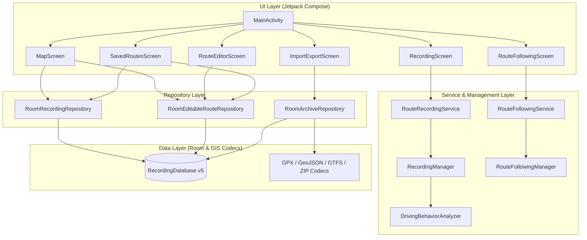
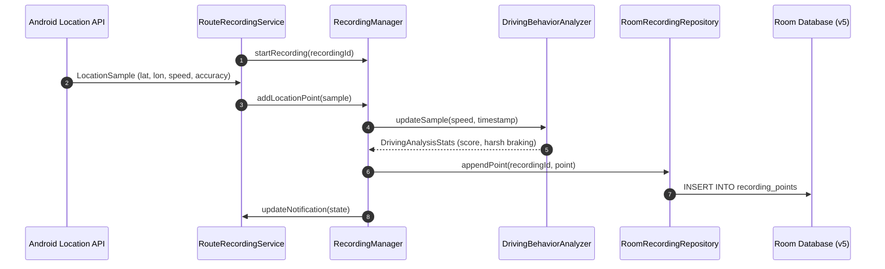
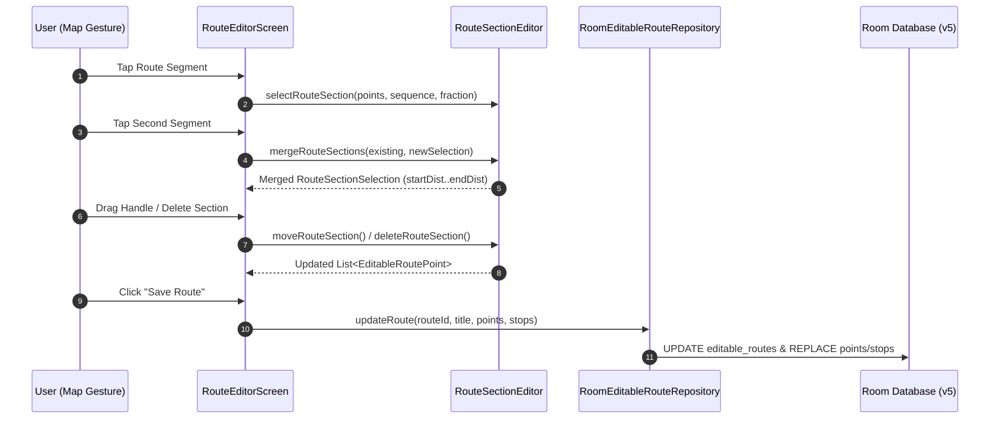
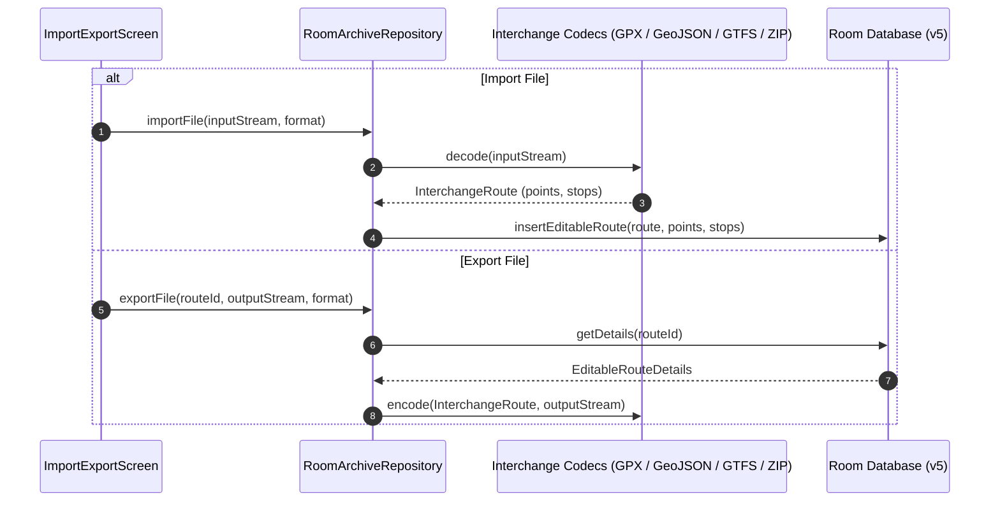

# Application Architecture — Linienbegleiter

This document details the architectural layout, subsystem interactions, state management, and data flow patterns of **Linienbegleiter**.

---

## 1. Architectural Overview

Linienbegleiter uses a **Single-Activity Architecture** built on Jetpack Compose (Material 3), Room Database, MapLibre SDK, and Android Foreground Services.

### Layer Diagram

---

## 2. Core Subsystems & Responsibilities

### 2.1. UI Layer (`com.example.linienbegleiter`)
- **[MainActivity.kt](../app/src/main/java/com/example/linienbegleiter/MainActivity.kt):** Main entry point, screen navigation state machine (`AppScreen`), bottom navigation bar (`MainNavigationBar`), global theme switching (`LinienbegleiterTheme`), and Settings.
- **[MapScreen.kt](../app/src/main/java/com/example/linienbegleiter/MapScreen.kt):** MapLibre `MapView` container rendering vector map layers, stop overlay items, direction arrows, current position GPS cursor with **dynamic motion vector and hardware compass sensor rotation (`Sensor.TYPE_ROTATION_VECTOR`)**, auto route framing (`LatLngBounds`), and top floating action toolbar (`🚀 Drive`, `🔴 GPS Record`, zoom controls).
- **[RecordingScreen.kt](../app/src/main/java/com/example/linienbegleiter/RecordingScreen.kt):** Dashboard for active GPS recording, tracking duration, distance, points, stops, and real-time Eco-Drive telemetry.
- **[RouteFollowingScreen.kt](../app/src/main/java/com/example/linienbegleiter/RouteFollowingScreen.kt):** Route navigation screen displaying progress, next stop, arrival-departure suggestions, and back-button confirmation dialog.
- **[RouteEditorScreen.kt](../app/src/main/java/com/example/linienbegleiter/RouteEditorScreen.kt):** Route geometry editor with multi-segment merged selection, framed stop cards, and route appearance controls.

### 2.2. Service & Foreground Layer (`com.example.linienbegleiter.service`)
- **RouteRecordingService:** Android Foreground Service (`location` type) executing background GPS logging and periodic checkpointing every 10 seconds.
- **RouteFollowingService:** Android Foreground Service (`location` type) driving route navigation, updating progress notifications, and providing quick action buttons for next-trip startup.

### 2.3. Data & Repository Layer (`com.example.linienbegleiter.data`)
- **[RecordingManager.kt](../app/src/main/java/com/example/linienbegleiter/data/recording/RecordingManager.kt):** Manages active GPS recording state, filtering GPS noise (`MAX_PLAUSIBLE_SPEED`), and integrating `DrivingBehaviorAnalyzer`.
- **[RouteFollowingManager.kt](../app/src/main/java/com/example/linienbegleiter/data/routes/RouteFollowingManager.kt):** Calculates progress along route polyline (`RouteProgressCalculator`), calculates deviation, and builds arrival-departure candidate suggestions (`buildNextRouteSuggestions`).
- **[RouteSectionEditor.kt](../app/src/main/java/com/example/linienbegleiter/data/routes/RouteSectionEditor.kt):** Spatial route section editor providing distance-based window selections, multi-segment selection merging (`mergeRouteSections`), smooth falloff transformation (`smoothInfluence`), and segment deletion.

---

## 3. Data Flow Diagrams

### 3.1. GPS Recording Data Flow

---

### 3.2. Route Geometry Editing & Saving Flow

---

### 3.3. Import & Export Flow

